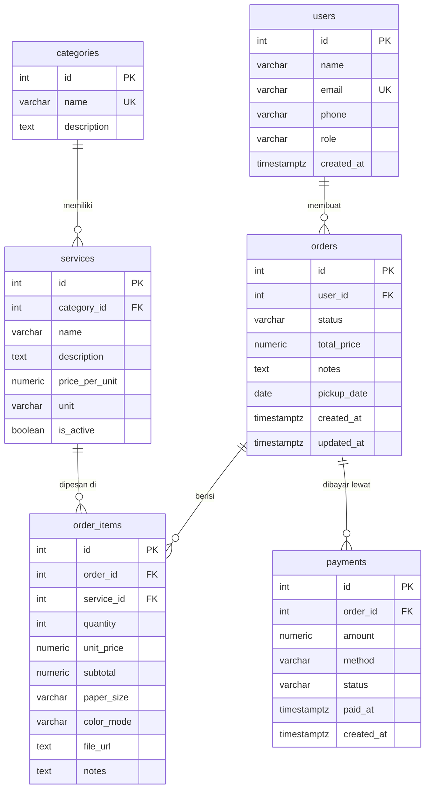

# PrintKu API — Sistem Pemesanan Printing

## 1. Deskripsi Project

**PrintKu** adalah REST API untuk sistem pemesanan jasa printing (fotokopi/percetakan). Pelanggan (`users`) dapat memilih layanan cetak (`services`) yang dikelompokkan dalam `categories`, membuat pesanan (`orders`) yang berisi satu atau lebih item cetak (`order_items`), lalu melakukan pembayaran (`payments`). Total harga pesanan dihitung otomatis oleh server berdasarkan harga layanan × jumlah.

**Teknologi:** Node.js, Express, PostgreSQL (Supabase/Neon), deploy di Vercel.

## 2. ERD / Skema Database

6 tabel, semua punya primary key dan saling terhubung lewat foreign key.



**Relasi:**
- `users` 1 — N `orders`
- `categories` 1 — N `services`
- `orders` 1 — N `order_items`
- `orders` 1 — N `payments`
- `orders` N — N `services` (lewat tabel pivot `order_items`)

> **Gambar ERD:** tempel isi file `db/erd.dbml` ke [dbdiagram.io](https://dbdiagram.io/d), lalu export sebagai gambar dan simpan ke `docs/erd.png`.

## 3. Link Deployment

**Base URL:** `https://GANTI-DENGAN-NAMA-PROJECT.vercel.app`

(Ganti setelah deploy. Semua contoh URL di bawah memakai `{{baseUrl}}` = base URL di atas.)

## 4. Daftar Endpoint

Semua request/response berformat JSON. Untuk request dengan body, tambahkan header `Content-Type: application/json`.

Format error selalu: `{ "error": "pesan" }`. Status code yang dipakai: `200`, `201`, `400` (input salah), `404` (data tidak ditemukan), `409` (data duplikat), `500` (error server).

| Resource | Endpoint |
|----------|----------|
| Categories | `GET /categories`, `GET /categories/:id`, `POST /categories`, `PUT /categories/:id`, `PATCH /categories/:id`, `DELETE /categories/:id` |
| Services | `GET /services`, `GET /services/:id`, `POST /services`, `PUT /services/:id`, `PATCH /services/:id`, `DELETE /services/:id` |
| Users | `GET /users`, `GET /users/:id`, `POST /users`, `PUT /users/:id`, `PATCH /users/:id`, `DELETE /users/:id` |
| Orders | `GET /orders`, `GET /orders/:id`, `POST /orders`, `PATCH /orders/:id`, `DELETE /orders/:id` |
| Payments | `GET /payments`, `GET /payments/:id`, `POST /payments`, `PATCH /payments/:id`, `DELETE /payments/:id` |

---

### A. Categories

#### Ambil Semua Kategori
- Method       : GET
- URL          : {{baseUrl}}/categories
- Deskripsi    : Mengambil seluruh kategori layanan
- Headers      : -
- Request Body : -
- Response Sukses (200):
  ```json
  {
    "message": "Daftar kategori",
    "data": [ { "id": 1, "name": "Dokumen", "description": "Cetak dokumen, makalah, skripsi, dan jilid" } ]
  }
  ```
- Response Error (500):
  ```json
  { "error": "Terjadi kesalahan pada server" }
  ```

#### Ambil Kategori by ID
- Method       : GET
- URL          : {{baseUrl}}/categories/1
- Deskripsi    : Mengambil satu kategori berdasarkan ID
- Headers      : -
- Request Body : -
- Response Sukses (200):
  ```json
  { "message": "Detail kategori", "data": { "id": 1, "name": "Dokumen", "description": "..." } }
  ```
- Response Error (404):
  ```json
  { "error": "Kategori tidak ditemukan" }
  ```

#### Tambah Kategori
- Method       : POST
- URL          : {{baseUrl}}/categories
- Deskripsi    : Menambahkan kategori baru
- Headers      : Content-Type: application/json
- Request Body :
  ```json
  { "name": "Stiker", "description": "Cetak stiker vinyl dan kertas" }
  ```
- Response Sukses (201):
  ```json
  { "message": "Kategori berhasil ditambahkan", "data": { "id": 4, "name": "Stiker", "description": "Cetak stiker vinyl dan kertas" } }
  ```
- Response Error (400):
  ```json
  { "error": "Field name wajib diisi" }
  ```

#### Ubah Seluruh Data Kategori
- Method       : PUT
- URL          : {{baseUrl}}/categories/4
- Deskripsi    : Mengubah seluruh data kategori
- Headers      : Content-Type: application/json
- Request Body :
  ```json
  { "name": "Stiker & Label", "description": "Cetak stiker dan label produk" }
  ```
- Response Sukses (200):
  ```json
  { "message": "Kategori berhasil diubah", "data": { "id": 4, "name": "Stiker & Label", "description": "Cetak stiker dan label produk" } }
  ```
- Response Error (404):
  ```json
  { "error": "Kategori tidak ditemukan" }
  ```

#### Ubah Sebagian Data Kategori
- Method       : PATCH
- URL          : {{baseUrl}}/categories/4
- Deskripsi    : Mengubah sebagian field kategori (name / description)
- Headers      : Content-Type: application/json
- Request Body :
  ```json
  { "description": "Stiker vinyl, kertas, dan label" }
  ```
- Response Sukses (200):
  ```json
  { "message": "Kategori berhasil diubah", "data": { "id": 4, "name": "Stiker & Label", "description": "Stiker vinyl, kertas, dan label" } }
  ```
- Response Error (400):
  ```json
  { "error": "Tidak ada field yang diubah. Field yang diizinkan: name, description" }
  ```

#### Hapus Kategori
- Method       : DELETE
- URL          : {{baseUrl}}/categories/4
- Deskripsi    : Menghapus kategori (gagal jika masih dipakai layanan)
- Headers      : -
- Request Body : -
- Response Sukses (200):
  ```json
  { "message": "Kategori berhasil dihapus", "data": { "id": 4, "name": "Stiker & Label", "description": "..." } }
  ```
- Response Error (404):
  ```json
  { "error": "Kategori tidak ditemukan" }
  ```
  Jika kategori masih dipakai layanan → `400`: `{ "error": "Data relasi (foreign key) tidak ditemukan atau masih dipakai data lain" }`

---

### B. Services

#### Ambil Semua Layanan
- Method       : GET
- URL          : {{baseUrl}}/services  (opsional filter: `?category_id=1&active=true`)
- Deskripsi    : Mengambil daftar layanan cetak beserta nama kategorinya
- Headers      : -
- Request Body : -
- Response Sukses (200):
  ```json
  {
    "message": "Daftar layanan",
    "data": [ { "id": 1, "category_id": 1, "name": "Print Hitam Putih A4", "price_per_unit": "500.00", "unit": "lembar", "is_active": true, "category_name": "Dokumen" } ]
  }
  ```
- Response Error (400):
  ```json
  { "error": "ID harus berupa angka bulat positif" }
  ```

#### Ambil Layanan by ID
- Method       : GET
- URL          : {{baseUrl}}/services/1
- Deskripsi    : Mengambil detail satu layanan
- Headers      : -
- Request Body : -
- Response Sukses (200):
  ```json
  { "message": "Detail layanan", "data": { "id": 1, "name": "Print Hitam Putih A4", "price_per_unit": "500.00", "category_name": "Dokumen" } }
  ```
- Response Error (404):
  ```json
  { "error": "Layanan tidak ditemukan" }
  ```

#### Tambah Layanan
- Method       : POST
- URL          : {{baseUrl}}/services
- Deskripsi    : Menambahkan layanan cetak baru
- Headers      : Content-Type: application/json
- Request Body :
  ```json
  { "category_id": 1, "name": "Print HVS A3", "description": "Cetak A3 hitam putih", "price_per_unit": 1500, "unit": "lembar" }
  ```
- Response Sukses (201):
  ```json
  { "message": "Layanan berhasil ditambahkan", "data": { "id": 6, "category_id": 1, "name": "Print HVS A3", "price_per_unit": "1500.00", "unit": "lembar", "is_active": true } }
  ```
- Response Error (400):
  ```json
  { "error": "Field price_per_unit wajib diisi" }
  ```

#### Ubah Seluruh Data Layanan
- Method       : PUT
- URL          : {{baseUrl}}/services/6
- Deskripsi    : Mengubah seluruh data layanan
- Headers      : Content-Type: application/json
- Request Body :
  ```json
  { "category_id": 1, "name": "Print HVS A3 Warna", "description": "Cetak A3 warna", "price_per_unit": 4000, "unit": "lembar", "is_active": true }
  ```
- Response Sukses (200):
  ```json
  { "message": "Layanan berhasil diubah", "data": { "id": 6, "name": "Print HVS A3 Warna", "price_per_unit": "4000.00" } }
  ```
- Response Error (404):
  ```json
  { "error": "Layanan tidak ditemukan" }
  ```

#### Ubah Sebagian Data Layanan
- Method       : PATCH
- URL          : {{baseUrl}}/services/6
- Deskripsi    : Mengubah sebagian field layanan (mis. harga atau status aktif)
- Headers      : Content-Type: application/json
- Request Body :
  ```json
  { "price_per_unit": 3500, "is_active": false }
  ```
- Response Sukses (200):
  ```json
  { "message": "Layanan berhasil diubah", "data": { "id": 6, "price_per_unit": "3500.00", "is_active": false } }
  ```
- Response Error (400):
  ```json
  { "error": "Field price_per_unit harus berupa angka >= 0" }
  ```

#### Hapus Layanan
- Method       : DELETE
- URL          : {{baseUrl}}/services/6
- Deskripsi    : Menghapus layanan (gagal jika sudah pernah dipesan)
- Headers      : -
- Request Body : -
- Response Sukses (200):
  ```json
  { "message": "Layanan berhasil dihapus", "data": { "id": 6, "name": "Print HVS A3 Warna" } }
  ```
- Response Error (404):
  ```json
  { "error": "Layanan tidak ditemukan" }
  ```

---

### C. Users

#### Ambil Semua User
- Method       : GET
- URL          : {{baseUrl}}/users
- Deskripsi    : Mengambil seluruh user
- Headers      : -
- Request Body : -
- Response Sukses (200):
  ```json
  { "message": "Daftar user", "data": [ { "id": 2, "name": "Budi Santoso", "email": "budi@example.com", "phone": "081200000002", "role": "customer" } ] }
  ```
- Response Error (500):
  ```json
  { "error": "Terjadi kesalahan pada server" }
  ```

#### Ambil User by ID
- Method       : GET
- URL          : {{baseUrl}}/users/2
- Deskripsi    : Mengambil satu user
- Headers      : -
- Request Body : -
- Response Sukses (200):
  ```json
  { "message": "Detail user", "data": { "id": 2, "name": "Budi Santoso", "email": "budi@example.com" } }
  ```
- Response Error (404):
  ```json
  { "error": "User tidak ditemukan" }
  ```

#### Tambah User
- Method       : POST
- URL          : {{baseUrl}}/users
- Deskripsi    : Mendaftarkan user baru (role: `customer` / `admin`)
- Headers      : Content-Type: application/json
- Request Body :
  ```json
  { "name": "Andi Wijaya", "email": "andi@example.com", "phone": "081234567890" }
  ```
- Response Sukses (201):
  ```json
  { "message": "User berhasil ditambahkan", "data": { "id": 4, "name": "Andi Wijaya", "email": "andi@example.com", "role": "customer" } }
  ```
- Response Error (409):
  ```json
  { "error": "Data sudah ada (nilai duplikat pada field unik)" }
  ```
  Jika field kosong → `400`: `{ "error": "Field email wajib diisi" }`

#### Ubah Seluruh Data User
- Method       : PUT
- URL          : {{baseUrl}}/users/4
- Deskripsi    : Mengubah seluruh data user
- Headers      : Content-Type: application/json
- Request Body :
  ```json
  { "name": "Andi Wijaya S.", "email": "andi@example.com", "phone": "081200009999", "role": "customer" }
  ```
- Response Sukses (200):
  ```json
  { "message": "User berhasil diubah", "data": { "id": 4, "name": "Andi Wijaya S.", "phone": "081200009999" } }
  ```
- Response Error (404):
  ```json
  { "error": "User tidak ditemukan" }
  ```

#### Ubah Sebagian Data User
- Method       : PATCH
- URL          : {{baseUrl}}/users/4
- Deskripsi    : Mengubah sebagian field user
- Headers      : Content-Type: application/json
- Request Body :
  ```json
  { "phone": "081211112222" }
  ```
- Response Sukses (200):
  ```json
  { "message": "User berhasil diubah", "data": { "id": 4, "phone": "081211112222" } }
  ```
- Response Error (400):
  ```json
  { "error": "Nilai salah satu field tidak memenuhi aturan yang diizinkan" }
  ```
  (contoh: `role` selain `customer`/`admin`)

#### Hapus User
- Method       : DELETE
- URL          : {{baseUrl}}/users/4
- Deskripsi    : Menghapus user (gagal jika user sudah punya pesanan)
- Headers      : -
- Request Body : -
- Response Sukses (200):
  ```json
  { "message": "User berhasil dihapus", "data": { "id": 4, "name": "Andi Wijaya S." } }
  ```
- Response Error (404):
  ```json
  { "error": "User tidak ditemukan" }
  ```

---

### D. Orders

#### Ambil Semua Pesanan
- Method       : GET
- URL          : {{baseUrl}}/orders  (opsional filter: `?status=pending&user_id=2`)
- Deskripsi    : Mengambil daftar pesanan (terbaru lebih dulu)
- Headers      : -
- Request Body : -
- Response Sukses (200):
  ```json
  { "message": "Daftar pesanan", "data": [ { "id": 1, "user_id": 2, "status": "pending", "total_price": "12500.00", "user_name": "Budi Santoso" } ] }
  ```
- Response Error (400):
  ```json
  { "error": "Status tidak valid. Pilihan: pending, processing, ready, completed, cancelled" }
  ```

#### Ambil Pesanan by ID
- Method       : GET
- URL          : {{baseUrl}}/orders/1
- Deskripsi    : Mengambil detail pesanan lengkap dengan item dan pembayarannya
- Headers      : -
- Request Body : -
- Response Sukses (200):
  ```json
  {
    "message": "Detail pesanan",
    "data": {
      "id": 1, "user_id": 2, "status": "pending", "total_price": "12500.00",
      "user_name": "Budi Santoso",
      "items": [ { "id": 1, "service_id": 1, "service_name": "Print Hitam Putih A4", "quantity": 10, "unit_price": "500.00", "subtotal": "5000.00" } ],
      "payments": [ { "id": 1, "amount": "12500.00", "method": "qris", "status": "pending" } ]
    }
  }
  ```
- Response Error (404):
  ```json
  { "error": "Pesanan tidak ditemukan" }
  ```

#### Buat Pesanan
- Method       : POST
- URL          : {{baseUrl}}/orders
- Deskripsi    : Membuat pesanan beserta item-itemnya. Harga & total dihitung otomatis oleh server (dalam 1 transaksi database).
- Headers      : Content-Type: application/json
- Request Body :
  ```json
  {
    "user_id": 2,
    "notes": "Tolong dijilid rapi",
    "pickup_date": "2026-10-12",
    "items": [
      { "service_id": 1, "quantity": 20, "paper_size": "A4", "color_mode": "bw", "file_url": "https://example.com/makalah.pdf" },
      { "service_id": 3, "quantity": 1 }
    ]
  }
  ```
- Response Sukses (201):
  ```json
  {
    "message": "Pesanan berhasil dibuat",
    "data": { "id": 2, "user_id": 2, "status": "pending", "total_price": "17000.00", "items": [ "..." ], "payments": [] }
  }
  ```
- Response Error (400):
  ```json
  { "error": "Field items harus berupa array dan minimal berisi 1 item" }
  ```
  Jika user/layanan tidak ada → `404`: `{ "error": "Layanan dengan id 99 tidak ditemukan" }`

#### Ubah Pesanan (status / catatan / tanggal ambil)
- Method       : PATCH
- URL          : {{baseUrl}}/orders/2
- Deskripsi    : Mengubah status pesanan (`pending`, `processing`, `ready`, `completed`, `cancelled`), catatan, atau tanggal ambil
- Headers      : Content-Type: application/json
- Request Body :
  ```json
  { "status": "processing" }
  ```
- Response Sukses (200):
  ```json
  { "message": "Pesanan berhasil diubah", "data": { "id": 2, "status": "processing", "total_price": "17000.00" } }
  ```
- Response Error (400):
  ```json
  { "error": "Status tidak valid. Pilihan: pending, processing, ready, completed, cancelled" }
  ```

#### Hapus Pesanan
- Method       : DELETE
- URL          : {{baseUrl}}/orders/2
- Deskripsi    : Menghapus pesanan beserta item dan pembayarannya (cascade)
- Headers      : -
- Request Body : -
- Response Sukses (200):
  ```json
  { "message": "Pesanan berhasil dihapus", "data": { "id": 2, "status": "processing" } }
  ```
- Response Error (404):
  ```json
  { "error": "Pesanan tidak ditemukan" }
  ```

---

### E. Payments

#### Ambil Semua Pembayaran
- Method       : GET
- URL          : {{baseUrl}}/payments  (opsional filter: `?order_id=1&status=paid`)
- Deskripsi    : Mengambil daftar pembayaran
- Headers      : -
- Request Body : -
- Response Sukses (200):
  ```json
  { "message": "Daftar pembayaran", "data": [ { "id": 1, "order_id": 1, "amount": "12500.00", "method": "qris", "status": "pending", "paid_at": null } ] }
  ```
- Response Error (400):
  ```json
  { "error": "ID harus berupa angka bulat positif" }
  ```

#### Ambil Pembayaran by ID
- Method       : GET
- URL          : {{baseUrl}}/payments/1
- Deskripsi    : Mengambil detail satu pembayaran
- Headers      : -
- Request Body : -
- Response Sukses (200):
  ```json
  { "message": "Detail pembayaran", "data": { "id": 1, "order_id": 1, "amount": "12500.00", "method": "qris", "status": "pending" } }
  ```
- Response Error (404):
  ```json
  { "error": "Pembayaran tidak ditemukan" }
  ```

#### Catat Pembayaran
- Method       : POST
- URL          : {{baseUrl}}/payments
- Deskripsi    : Mencatat pembayaran untuk sebuah pesanan. Method: `cash`, `transfer`, `qris`, `ewallet`. Status: `pending` (default), `paid`, `failed`.
- Headers      : Content-Type: application/json
- Request Body :
  ```json
  { "order_id": 1, "amount": 12500, "method": "transfer" }
  ```
- Response Sukses (201):
  ```json
  { "message": "Pembayaran berhasil dicatat", "data": { "id": 2, "order_id": 1, "amount": "12500.00", "method": "transfer", "status": "pending", "paid_at": null } }
  ```
- Response Error (400):
  ```json
  { "error": "Method tidak valid. Pilihan: cash, transfer, qris, ewallet" }
  ```
  Jika pesanan tidak ada → `404`: `{ "error": "Pesanan tidak ditemukan" }`

#### Ubah Status Pembayaran
- Method       : PATCH
- URL          : {{baseUrl}}/payments/2
- Deskripsi    : Mengubah status pembayaran (mis. `pending` → `paid`; `paid_at` terisi otomatis)
- Headers      : Content-Type: application/json
- Request Body :
  ```json
  { "status": "paid" }
  ```
- Response Sukses (200):
  ```json
  { "message": "Status pembayaran berhasil diubah", "data": { "id": 2, "status": "paid", "paid_at": "2026-10-09T06:10:00.000Z" } }
  ```
- Response Error (400):
  ```json
  { "error": "Field status wajib diisi" }
  ```

#### Hapus Pembayaran
- Method       : DELETE
- URL          : {{baseUrl}}/payments/2
- Deskripsi    : Menghapus catatan pembayaran
- Headers      : -
- Request Body : -
- Response Sukses (200):
  ```json
  { "message": "Pembayaran berhasil dihapus", "data": { "id": 2 } }
  ```
- Response Error (404):
  ```json
  { "error": "Pembayaran tidak ditemukan" }
  ```

## 5. Cara Menjalankan Secara Lokal

1. **Prasyarat:** Node.js 18+ dan sebuah database PostgreSQL online (Supabase atau Neon).
2. Clone repo dan install dependency:
   ```bash
   git clone <link-repository-kamu>
   cd printku-api
   npm install
   ```
3. Salin `.env.example` menjadi `.env`, lalu isi `DATABASE_URL` dengan connection string database kamu.
4. Buat tabel (dan data contoh opsional):
   ```bash
   npm run db:init -- --seed
   ```
   Atau salin isi `db/schema.sql` (lalu `db/seed.sql`) ke SQL Editor Supabase/Neon.
5. Jalankan server:
   ```bash
   npm start
   ```
   API aktif di `http://localhost:3000`.

## 6. Deploy ke Vercel

1. Push project ke GitHub (pastikan `.env` **tidak** ikut ter-commit; sudah ada di `.gitignore`).
2. Di [vercel.com](https://vercel.com) → **Add New Project** → import repository.
3. Buka **Settings → Environment Variables**, tambahkan `DATABASE_URL` berisi connection string database.
4. Klik **Deploy**. Konfigurasi routing sudah ada di `vercel.json`, dan entry point serverless di `api/index.js`.
5. Tes dengan membuka `https://<nama-project>.vercel.app/` — harus muncul pesan "PrintKu API".

> Tips Supabase: gunakan connection string **Transaction pooler** (port 6543) agar cocok dengan serverless Vercel.

## 7. Pengujian

Import file `postman/PrintKu.postman_collection.json` ke Postman / Thunder Client, lalu ubah variabel `baseUrl` menjadi URL Vercel kamu. Jalankan setiap request dan ambil screenshot request + response sebagai bukti pengujian.

Urutan pengujian yang disarankan: Categories → Services → Users → Orders → Payments.

## Struktur Project

```
printku-api/
├── api/index.js            # entry point Vercel
├── src/
│   ├── app.js              # konfigurasi Express + error handler
│   ├── server.js           # entry point lokal
│   ├── db.js               # koneksi PostgreSQL
│   ├── utils.js            # helper validasi
│   └── routes/             # categories, services, users, orders, payments
├── db/                     # schema.sql, seed.sql, erd.dbml
├── scripts/init-db.js
├── postman/                # collection untuk pengujian
├── vercel.json
└── .env.example
```
